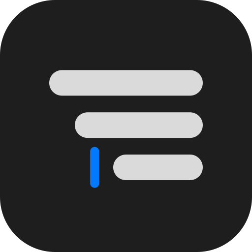
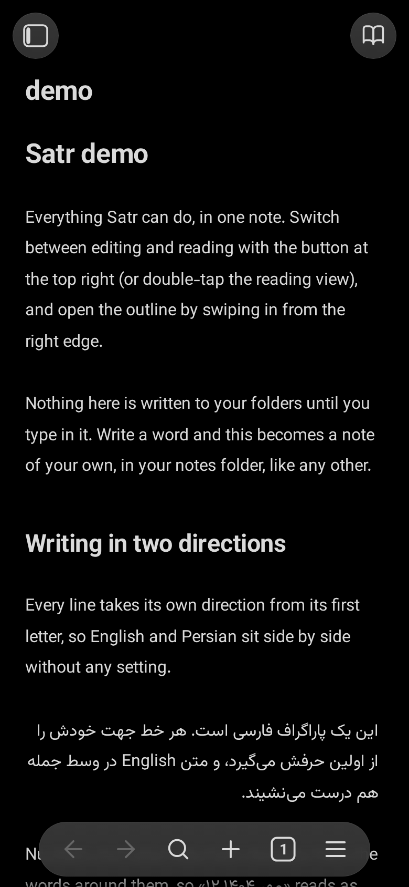
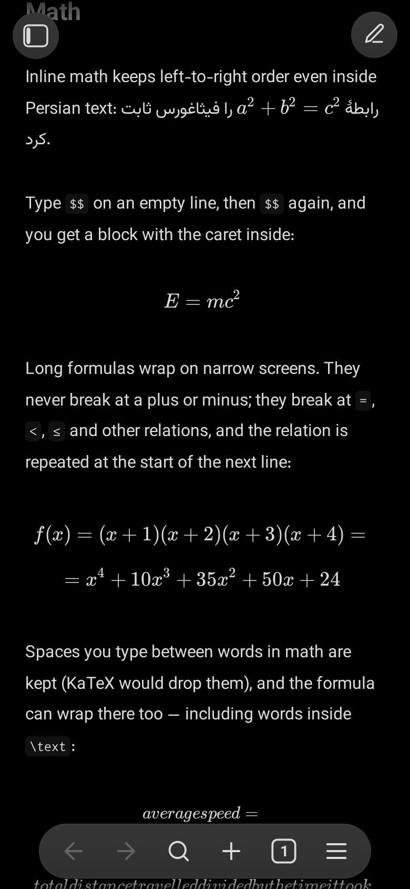

# Satr

[](https://github.com/MSadraShakouri/satr/actions/workflows/build-android.yml)
[](https://github.com/MSadraShakouri/satr/releases/latest)
[](https://github.com/MSadraShakouri/satr/releases)
[](LICENSE)

<p align="center">
  
</p>

**Satr** is a free, open-source Markdown editor for Android that writes **Persian and English side by side** — in the same note, on the same line. It looks and feels like Obsidian's phone app, works on plain `.md` files in your own folders, and needs no account, no sync service and no network.

*Satr* (سطر) means "line".

<p align="center">
  
  
</p>

## Highlights

- ✍️ **True bidirectional writing.** Every line takes its direction from its first letter. Numbers, dates, math and code sit correctly inside Persian prose — in the editor, the reading view and the PDF alike.
- 🧮 **Math with KaTeX.** Live preview while editing, long formulas that wrap at `=` and `≤` (never at a bare `+`), and Persian words inside formulas that read right to left.
- 📄 **PDF export.** A4, one or two columns, column order that follows the note's language, footnotes at the foot of the page, and page numbers in Persian digits if your note reads that way.
- 📅 **Dates done right.** Discord-style `<t:…>` timestamps in your own language, a calendar sheet that writes them for you — Gregorian or Jalali — and a live sample of every format as you pick.
- 🗂️ **Your files, your folders.** Notes are plain `.md` files you can edit anywhere. Spaces are shortcuts to folders; notes open in tabs you can rearrange; every note remembers its reading position, caret and folds.
- 🔍 **Search and outline.** Find and replace with regular expressions, search across all notes, and an outline tree that flips to the note's direction.
- 📝 **Obsidian's Markdown.** `[[wiki links]]`, `==highlights==`, task lists, footnotes in a popover, folding headings — and ordered lists that count in Persian digits or Abjad letters (`الف.`), exactly as typed.
- 📂 **Any file opens.** Code with syntax highlighting, CSV as a table, HTML as a full page, images — and PDFs in a built-in reader with its own chrome, search and one-finger zoom.
- ⚡ **Fast and private.** Instant cold start, fully offline, and a fresh install writes nothing until you type your first word.

<p>
  
  
  
</p>
<p>
  
  
</p>

## Install

Download `satr-debug-<version>.apk` from [Releases](https://github.com/MSadraShakouri/satr/releases/latest) and install it. Android 6 or later is required. On first run Satr asks for "All files access" so it can open your notes wherever they are.

Each release is signed with the same key, so a new APK installs over the old one and keeps your settings.

## Develop

```sh
npm install
npm run dev          # the web app at http://localhost:5173
npm run build        # type-check and build to dist/
npm start            # build, then serve dist/ on the network for a phone
```

The web app is the same editor in a browser — notes live in the browser's storage — and is a fine way to try Satr without an Android device.

Browser tests (Playwright) cover editor input, selection geometry, pagination and PDF rendering:

```sh
npx playwright install chromium   # once
npm test
```

To build the Android app, JDK 21 and the Android SDK are needed:

```sh
npm run android:sync
cd android && ./gradlew assembleDebug
```

<details>
<summary>Release signing (maintainers)</summary>

GitHub Actions builds the APK when a `v*` tag matching `package.json`'s version is pushed, and publishes it as a release. It signs with the keystore in the `ANDROID_KEYSTORE_BASE64` secret (PKCS12, alias `satr`, password `android`):

```sh
keytool -genkeypair -v -keystore satr-debug.jks -storetype PKCS12 -alias satr -keyalg RSA -keysize 2048 -validity 10000 -storepass android -keypass android -dname "CN=Satr"
base64 -w0 satr-debug.jks > satr-debug.b64
gh secret set ANDROID_KEYSTORE_BASE64 < satr-debug.b64
```

Keep both files out of git; they're already in `.gitignore`.
</details>

## Built with

- Vite, TypeScript and CodeMirror 6
- marked, DOMPurify, KaTeX and highlight.js
- Paged.js for the PDF, PDFium for the reader
- Capacitor 7 for Android
- Fonts: Vazirmatn, Vazir Code and XB Zar

## License

[MIT](LICENSE) — free to use, study, change and share.

## Roadmap

See [ROADMAP.md](ROADMAP.md). Screenshots in this README are from the web version of the app.

<details>
<summary>The fine print — how Satr treats your text</summary>

**Direction.** A line's direction comes from its first strong letter. Numbers and dates infer theirs from the surrounding prose; math and code are isolated islands that stay left-to-right wherever they sit. A formula, a code span, a timestamp chip — each is one thing, standing on the same side of a Persian line in the editor as in the reading view and the PDF. The line numbers keep the left edge; only the outline reads the note's majority.

**Live preview.** Markdown syntax shows only on the line you're editing — Obsidian's rule, as the editor's normal state. Inside `$…$` nothing is Markdown at all: a `**` is never bold, a `[a](b)` never a link. Switching between editing and reading keeps your place, measuring rendered formulas and tables to compensate the scroll.

**Math.** Display formulas break first at the writer's own line ends, then at commas, then at relations — repeated on the next line — and last at spaces between words. A Persian phrase inside a formula stays a single right-to-left run. Drawn signs scale with the font exactly like letters. The source is never changed.

**Lists.** One list, one language: the head decides the digits (`1.`, `۱.`) and the letters (`a.`, `الف.`); markers hang beside their text and keep the punctuation you typed. Lists renumber themselves on every edit, counting from the head's own number.

**PDF.** Vazirmatn on A4, one or two columns remembered per file, headings kept with what follows them, footnotes at the foot of each page or column, ordered-list markers hung and lined up, `۱۰۰.` never running into the margin, and your own CSS if the note brings it.

**Files.** Spaces are shortcuts to folders and Satr never writes config into them. Any UTF-8 text file is editable whatever its extension; anything else opens read-only, so Satr can never write rubbish over a file it doesn't understand. An `.html` file is a page, given the whole pane with its own stylesheet in a sealed frame.
</details>
