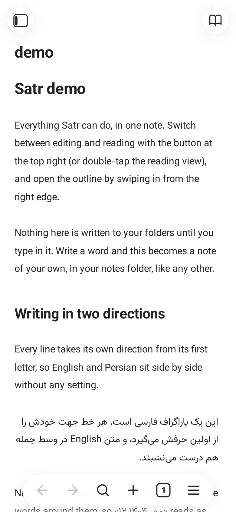
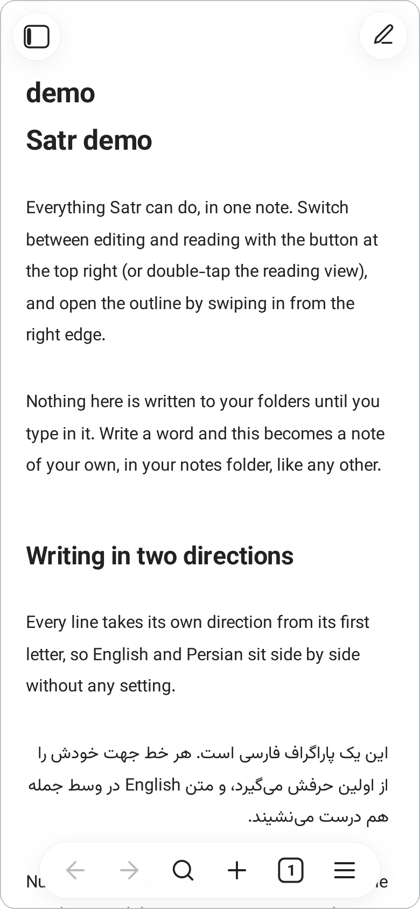
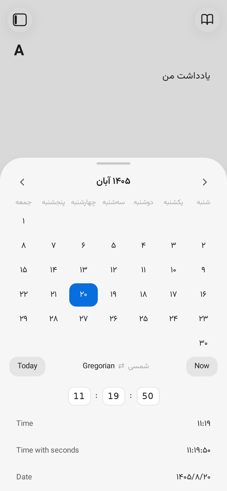
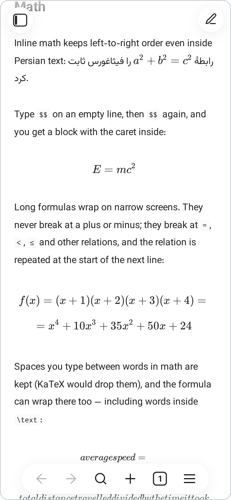
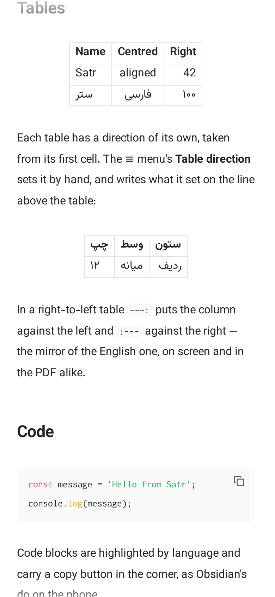
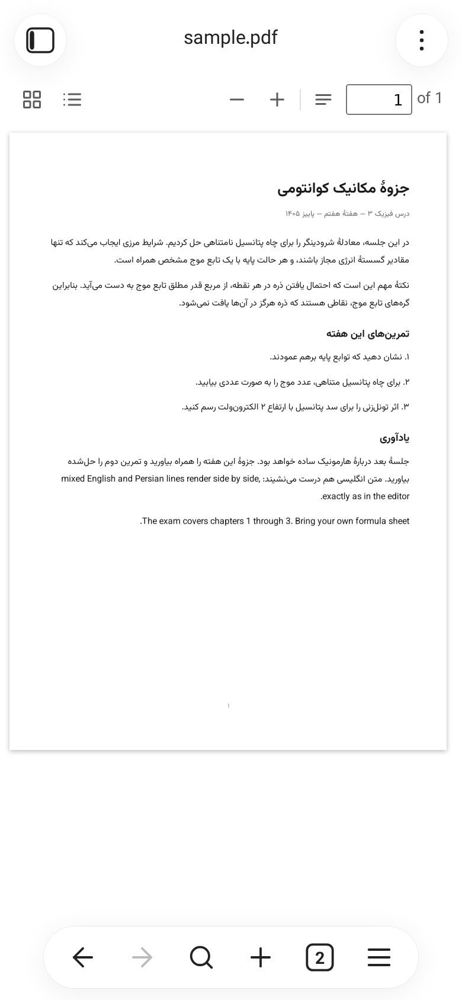
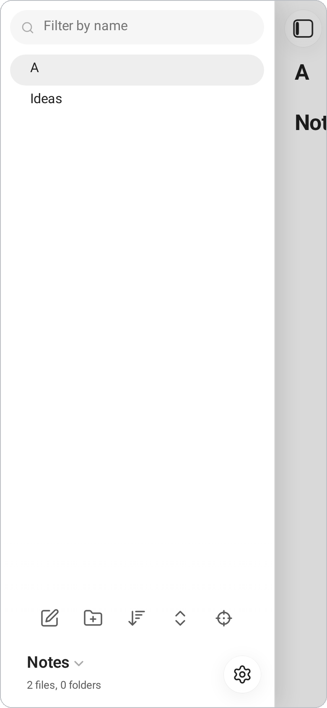

<p align="center">
  <picture>
    <source media="(prefers-color-scheme: dark)" srcset="docs/logo-dark.png">
    
  </picture>
</p>

<h3 align="center">A Markdown editor for Android that writes<br>Persian and English side by side.</h3>

<p align="center">
  <a href="https://github.com/MSadraShakouri/satr/actions/workflows/build-android.yml"></a>
  <a href="https://github.com/MSadraShakouri/satr/releases/latest"></a>
  <a href="https://github.com/MSadraShakouri/satr/releases"></a>
  <a href="LICENSE"></a>
</p>

<p align="center">
  <a href="#install">Download</a> ·
  <a href="#features">Features</a> ·
  <a href="#screenshots">Screenshots</a> ·
  <a href="#develop">Develop</a> ·
  <a href="#roadmap">Roadmap</a>
</p>

<p align="center">
  <picture>
    <source media="(prefers-color-scheme: dark)" srcset="docs/screenshots/hero-editor-dark.png">
    
  </picture>
</p>

*Satr* (سطر, "line") looks and feels like Obsidian's phone app and works on **plain `.md` files in your own folders** — no database, no account, no sync service, no network. What makes it different is the writing itself: every line takes its direction from its first letter, and numbers, dates, formulas and code sit correctly inside Persian prose in the editor, the reading view and the PDF alike.

## Features

| | |
| --- | --- |
| ✍️ **True bidirectional writing** — every line follows its first letter; numbers, dates, math and code sit correctly in Persian prose. | 🧮 **Math with KaTeX** — live preview while editing, long formulas that wrap at `=` and `≤` but never at a bare `+`, Persian words inside formulas that read right to left. |
| 📄 **PDF export** — A4, one or two columns, column order that follows the note's language, footnotes at the foot, page numbers in Persian digits. | 📅 **Dates done right** — Discord-style `<t:…>` stamps in your own language, written for you by a Gregorian **or Jalali** calendar sheet with a live sample of every format. |
| 🗂️ **Your files, your folders** — plain `.md` you can edit anywhere; Spaces as shortcuts; tabs you rearrange; each note remembers its place, caret and folds. | 🔍 **Search and outline** — find & replace with regular expressions, search across every note, an outline tree that flips with the note's direction. |
| 📝 **Obsidian's Markdown** — `[[wiki links]]` show their titles until edited, alongside `==highlights==`, task lists, footnote popovers, folding headings and lists in Persian digits or Abjad letters (`الف.`). | 📂 **Any file opens** — code with highlighting, CSV as a table, HTML as a full page, images, and PDFs in a built-in reader with its own chrome and one-finger zoom. |
| ⚡ **Fast and private** — instant cold start, fully offline, and a fresh install writes nothing until your first keystroke. | 🌗 **Light and dark** — themes that follow the system, with dark pages for documents that are already dark. |

## Screenshots

<table>
  <tr>
    <td width="50%" align="center" valign="top">
      
      <br><sub><b>Reading view</b> — the demo note</sub>
    </td>
    <td width="50%" align="center" valign="top">
      
      <br><sub><b>Jalali sheet</b> — آبان ۱۴۰۵</sub>
    </td>
  </tr>
  <tr>
    <td width="50%" align="center" valign="top">
      <picture>
        <source media="(prefers-color-scheme: dark)" srcset="docs/screenshots/reading-math-dark.png">
        
      </picture>
      <br><sub><b>Display math</b> — follows your theme</sub>
    </td>
    <td width="50%" align="center" valign="top">
      
      <br><sub><b>RTL tables</b> — the mirror image</sub>
    </td>
  </tr>
  <tr>
    <td width="50%" align="center" valign="top">
      
      <br><sub><b>PDF reader</b> — a Persian document</sub>
    </td>
    <td width="50%" align="center" valign="top">
      
      <br><sub><b>Files</b> — spaces and folders</sub>
    </td>
  </tr>
</table>

*All screenshots are the real app — the web build at a phone viewport — using the demo note, a seeded vault and an imported PDF.*

## Install

Download `satr-debug-<version>.apk` from [Releases](https://github.com/MSadraShakouri/satr/releases/latest) and install it.

> [!NOTE]
> Android 6 or later is required. On first run Satr asks for **All files access**, so it can open your notes wherever they are. Each release is signed with the same key — a new APK installs over the old one and keeps your settings.

## Develop

> [!TIP]
> No Android device at hand? The web app is the same editor in a browser — `npm run dev` and open it. Notes live in the browser's storage.

```sh
npm install
npm run dev          # the web app at http://localhost:5173
npm run build        # type-check and build to dist/
npm start            # build, then serve dist/ on the network for a phone
```

Browser tests (Playwright) cover editor input, selection geometry, pagination and PDF rendering:

```sh
npx playwright install chromium   # once
npm test
```

To build the Android app, JDK 21 and the Android SDK are needed:

```sh
npm run android:sync
cd android && ./gradlew assembleDebug
```

<details>
<summary>Release signing (maintainers)</summary>

GitHub Actions builds and publishes an APK for every pushed `v*` tag; the tag supplies the APK version. Keep `package.json` and the lockfile at the same version for local builds. It signs with the keystore in the `ANDROID_KEYSTORE_BASE64` secret (PKCS12, alias `satr`, password `android`):

```sh
keytool -genkeypair -v -keystore satr-debug.jks -storetype PKCS12 -alias satr -keyalg RSA -keysize 2048 -validity 10000 -storepass android -keypass android -dname "CN=Satr"
base64 -w0 satr-debug.jks > satr-debug.b64
gh secret set ANDROID_KEYSTORE_BASE64 < satr-debug.b64
```

Keep both files out of git; they're already in `.gitignore`.
</details>

## Built with

Vite, TypeScript and CodeMirror 6 · marked, DOMPurify, KaTeX and highlight.js · Paged.js for the PDF, PDFium for the reader · Capacitor 7 for Android · fonts: Vazirmatn, Vazir Code, XB Zar.

## Roadmap

See [ROADMAP.md](ROADMAP.md).

## License

[MIT](LICENSE) — free to use, study, change and share.

<details>
<summary>The fine print — how Satr treats your text</summary>

**Direction.** A line's direction comes from its first strong letter. Numbers and dates infer theirs from the surrounding prose; math and code are isolated islands that stay left-to-right wherever they sit. A formula, a code span, a timestamp chip — each is one thing, standing on the same side of a Persian line in the editor as in the reading view and the PDF. The line numbers keep the left edge; only the outline reads the note's majority.

**Live preview.** Markdown syntax shows only on the line you're editing — Obsidian's rule, as the editor's normal state. Inside `$…$` nothing is Markdown at all: a `**` is never bold, a `[a](b)` never a link. Switching between editing and reading keeps your place, measuring rendered formulas and tables to compensate the scroll.

**Math.** Display formulas break first at the writer's own line ends, then at commas, then at relations — repeated on the next line — and last at spaces between words. A Persian phrase inside a formula stays a single right-to-left run. Drawn signs scale with the font exactly like letters. The source is never changed.

**Lists.** One list, one language: the head decides the digits (`1.`, `۱.`) and the letters (`a.`, `الف.`); markers hang beside their text and keep the punctuation you typed. Lists renumber themselves on every edit, counting from the head's own number.

**PDF.** Vazirmatn on A4, one or two columns remembered per file, headings kept with what follows them, footnotes at the foot of each page or column, ordered-list markers hung and lined up, `۱۰۰.` never running into the margin, and your own CSS if the note brings it.

**Files.** Spaces are shortcuts to folders and Satr never writes config into them. Any UTF-8 text file is editable whatever its extension; anything else opens read-only, so Satr can never write rubbish over a file it doesn't understand. An `.html` file is a page, given the whole pane with its own stylesheet in a sealed frame.
</details>
